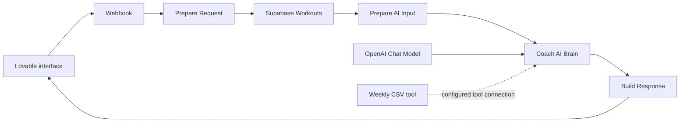

# FitTrack — Workout data and AI integration

I built FitTrack using Lovable for the interface, Supabase for workout storage and n8n for the AI workflow. Users can log workouts and ask free-form questions in Hebrew about the workout data they entered, including recorded weights, sets, reps, progress and workout summaries. Answers depend on the available records and the implemented reasoning.

This portfolio documents a project that previously ran on a VPS. Running it again requires an n8n server, configured service connections and valid API keys.

## My contribution

I chose and connected the services, defined how workout data reaches the assistant and iterated on the instructions using AI development tools. The prompt specifies how to treat warm-up sets, missing values, unilateral exercises and workout duration.

## How a question travels through the system

[Inspect the sanitized original coach workflow](coach-reference.json). Node names and connections are preserved. Credential references were removed and service endpoints replaced. Importing this reference requires configuring the HTTP requests and credentials before use.

The separate weekly export workflow retrieves workouts, filters a date range, builds rows and returns CSV. It is documented as an additional component whose integration still needs testing.

## Evidence and verification

In a previous app session, a user asked for their highest bench-press weight. The interface returned 70 kg and displayed supporting sets. This demonstrates a response in the app. The historical maximum has not been independently verified against the full dataset.

The coach prompt currently emphasizes first-versus-last workout comparisons. A useful acceptance check is therefore a peak in the middle workout:

| Workout | Working-set weight | Reps |
|---|---:|---:|
| First | 50 kg | 8 |
| Middle | 80 kg | 5 |
| Last | 65 kg | 8 |

Expected answer: **80 kg in the middle workout**. This is a proposed test with fictional data; its live execution remains pending.

## What I would improve next

- Verify user authorization before querying workouts using a supplied user ID.
- Compute numerical aggregates deterministically, then ask the model to explain the result.
- Validate the weekly export request shape and quote CSV fields containing commas.
- Test the weekly CSV tool using a production endpoint in a configured test environment. The original export points to a webhook-test endpoint.

These follow-ups come from inspecting the exported workflow and are distinct from completed functionality.
