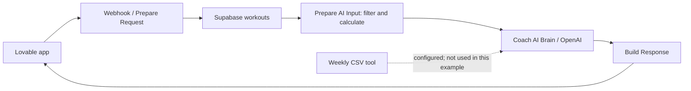
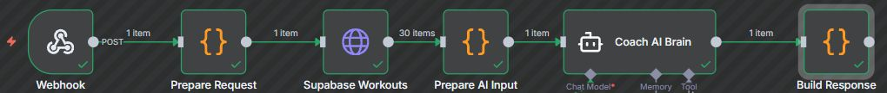
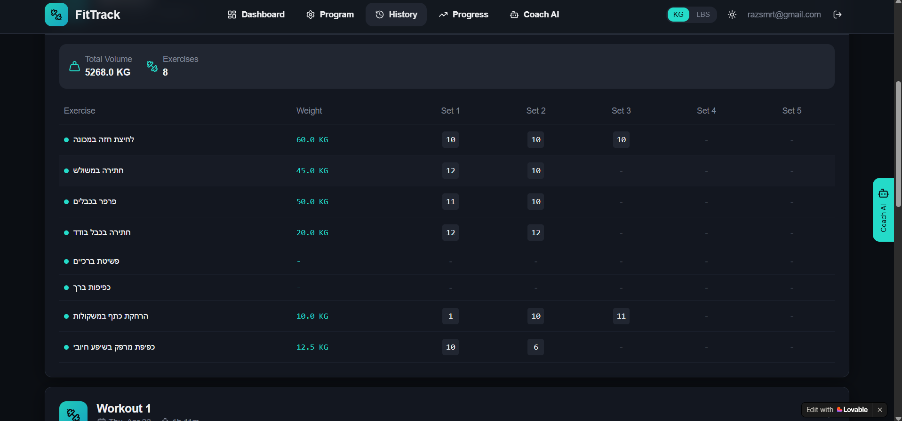
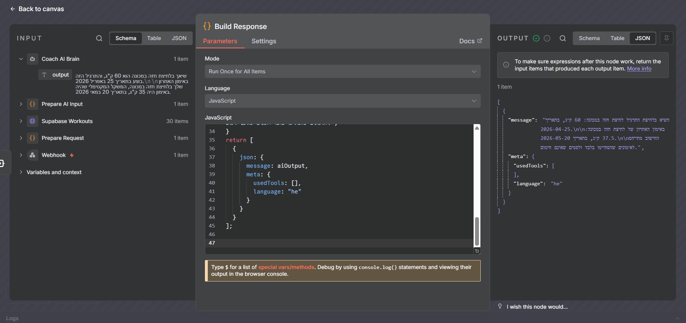

# FitTrack — Workout tracking and AI integration

I built a workout-tracking web app with Lovable, Supabase and n8n. Users log workouts and ask questions in Hebrew about their recorded training data. This case study focuses on connecting the interface, database, webhook and AI workflow.

## My contribution

I selected and connected the services, defined how workout records reach the assistant, and iterated using AI development tools. During portfolio review, I used AI assistance to investigate incorrect answers and add code-based calculations for supported maximum-weight questions.

## Integration flow

## Demonstration

The app sends a question to n8n, which retrieves workout records from Supabase. The preparation step filters completed workouts and computes per-exercise records. For supported maximum-weight questions that name an exact exercise, the response step uses the calculated values directly.

Execution path: Webhook → Prepare Request → Supabase Workouts → Prepare AI Input → Coach AI Brain → Build Response. Service URLs and account identifiers are outside the screenshot.

In the reviewed example, the highest working-set weight for machine chest press was **60 kg** on **25 April 2026**. The maximum in the latest completed session was **37.5 kg** on **20 May 2026**. The latest session contained sets at 35, 37.5 and 37.5 kg; the History row showed 35, so the underlying sets were checked rather than treating that row as the session maximum. Dates use Asia/Jerusalem.

An earlier AI answer included an unfinished workout and later confused exercises. Prompt changes alone did not reliably solve the numerical errors. The supported maximum-weight response now comes from code, with clarification requested for the tested ambiguous follow-up wording. Other free-form answers have not been comprehensively validated.

The final response uses the calculated maximum. The AI intermediate output on the left still shows 35 kg; the final output on the right correctly returns 37.5 kg. The weekly CSV tool was not called in this run.

## Workflow reference and limitations

[Sanitized original workflow reference](coach-reference.json): this preserves the original structure, not the latest patched implementation. Credential references were removed and HTTP configurations replaced. It is a reference for the integration, not a ready-to-run deployment.

The weekly CSV export is a separate component and was not used in the demonstrated question. Its end-to-end integration remains unverified. A proposed synthetic test with a middle-session peak has not been executed live.

This is a documented portfolio project, not a maintained public service. Running it requires an n8n server, valid API keys and configured connections. User authorization at the webhook/database boundary and comprehensive response testing remain follow-up work.
